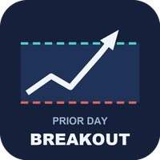
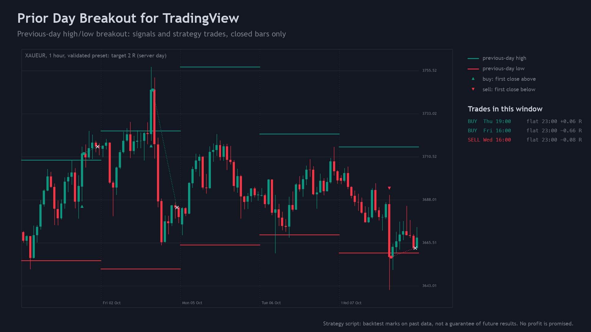
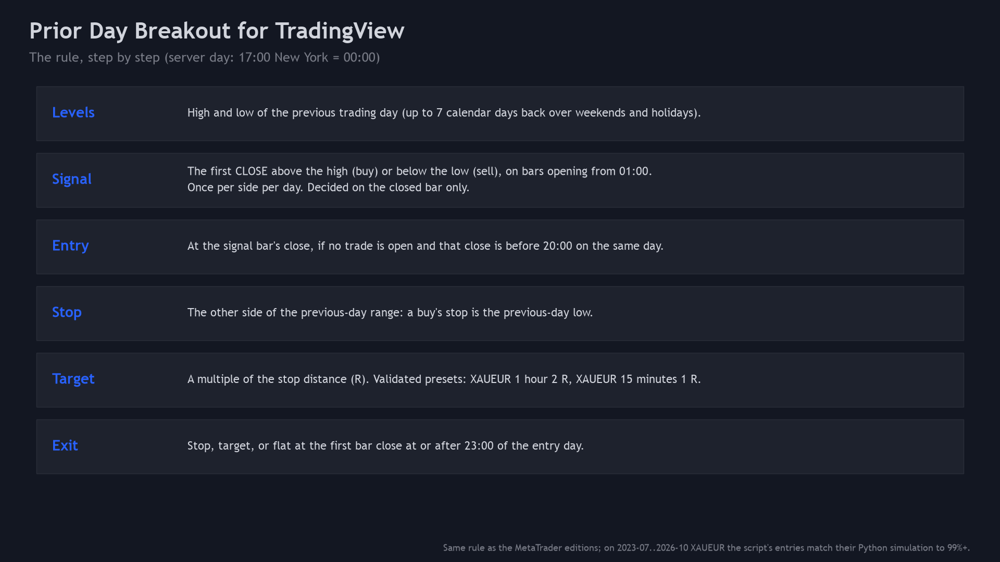
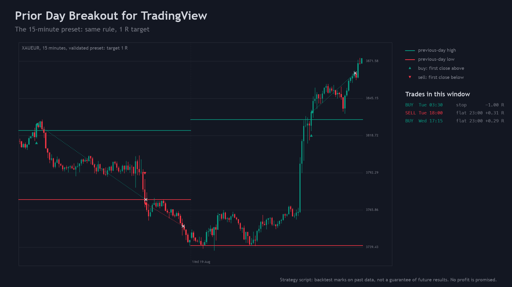
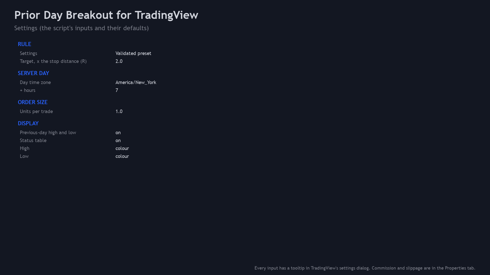
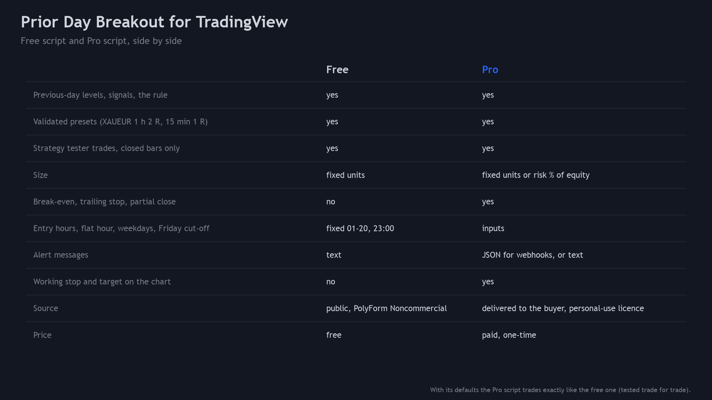
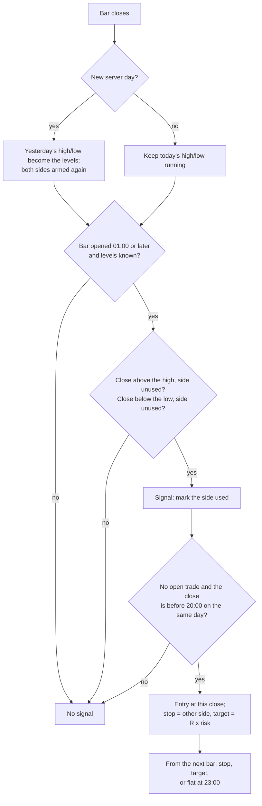

<p align="center"></p>

# Prior Day Breakout for TradingView (Pine Script v6)

A free TradingView **strategy** script: it draws the previous trading day's high and low and trades the first close
beyond either one, with the stop on the other side of the range, a target in multiples of the stop distance (R) and a
flat exit at 23:00 server time. **Closed bars only.** Pine Script v6 source, a Python reference of the rules, and the
test that checks the script's levels, signals and strategy trades against the reference.

**Website:** [allanninal.dev](https://www.allanninal.dev) · MetaTrader editions: [allanninal.dev/mql5](https://www.allanninal.dev/mql5/)
· **Contact:** message me on [LinkedIn](https://www.linkedin.com/in/allanninal/).



> A strategy script places simulated trades in TradingView's Strategy Tester; it does not trade at a broker. Nothing
> here is a profit claim (see [Honest limits](#honest-limits)).

## Contents

1. [Install in the Pine Editor](#install-in-the-pine-editor)
2. [What it is and who it is for](#what-it-is-and-who-it-is-for)
3. [How it works](#how-it-works)
4. [Non-repainting and fills](#non-repainting-and-fills)
5. [Inputs and alerts](#inputs-and-alerts)
6. [Tests](#tests)
7. [Honest limits](#honest-limits)
8. [Free vs Pro](#free-vs-pro)
9. [Licence](#licence)

## Install in the Pine Editor

Works on every TradingView plan, including the free Basic plan. The script is not published on TradingView; you add it
from this source.

1. Open [`pine/PriorDayBreakout.pine`](pine/PriorDayBreakout.pine) and copy the whole file (the "Raw" button, then
   select all).
2. On a TradingView chart, open the **Pine Editor** tab at the bottom, create a new strategy and replace its text with
   the copied code.
3. Click **Save**, then **Add to chart**. The strategy appears as "PDB"; its trades are in the **Strategy Tester** tab.
4. In the strategy's **Properties** tab, set your own commission and slippage (see [Inputs and alerts](#inputs-and-alerts)).

## What it is and who it is for

**What:** a previous-day high/low breakout, rule for rule the one in the MetaTrader 5 editions (Prior Day Breakout and
Prior Day Breakout Pro), with two **validated presets**: **XAUEUR 1 hour with a 2 R target** and **XAUEUR 15 minutes with
a 1 R target**. These are the settings that passed both backtests of the MetaTrader edition (a Python out-of-sample test
and the MT5 Strategy Tester). On those charts the script picks the preset's target by itself; on any other chart it
uses the target you type.

**For:** traders who want a written, checkable breakout rule to study in TradingView's Strategy Tester, and to get an
alert when it fires.

**Not for:** anyone looking for a promised result. See [Honest limits](#honest-limits).

| | |
|---|---|
|  |  |
|  |  |

Image notes: the charts are drawn from the Python reference on broker price history (server time), which the script
matches bar for bar and trade for trade (see [Tests](#tests)); they are illustrations, not TradingView captures.

## How it works

### The server day

The levels come from a **trading day**, and where a day starts changes the high and low. By default the day starts at
**17:00 New York time** (input "Day time zone" `America/New_York`, "+ hours" `7`), which is 00:00 on the server clock
most MetaTrader brokers use, all year round. Every time below (01:00, 20:00, 23:00) is on that clock. For a day that
starts at midnight UTC, set `UTC` and `0`.

### The rule

| Step | Rule |
|---|---|
| Levels | High and low of the previous trading day that has bars, up to 7 calendar days back (weekends, holidays). The chart's first day is usually cut, so it never serves as a previous day |
| Signal | On a bar opening at 01:00 or later: close **above** the previous-day high = buy, close **below** the previous-day low = sell. Once per side per day; a side is used up by its first signal even when no trade follows |
| Entry | At the signal bar's close, when no trade is open and that close is on the same day and before 20:00 |
| Stop | The other side of the previous-day range (a buy's stop is the previous-day low) |
| Target | Entry + target x (entry - stop): 2 R on the XAUEUR 1-hour preset, 1 R on the 15-minute preset, else the input |
| Exit | Stop or target from the next bar on, or flat at the close of the first bar that ends at or after 23:00 on the entry day |

### Per-bar flow



## Non-repainting and fills

- Signals are decided on **closed bars** (`barstate.isconfirmed`); the levels use only finished days. No
  `request.security`, no future bars.
- `process_orders_on_close = true`: the order fills at the signal bar's close, the moment a live alert fires. In a
  continuous market that close is the next bar's open, which is where the MetaTrader editions fill.
- Stop and target work from the bar after the entry. Inside a bar, TradingView's Strategy Tester assumes the price
  went first to the extreme nearer the open; the reference uses the same assumption. A real market path inside the bar
  can differ, so a bar that touches both the stop and the target is a guess in every bar-based backtest.

This was tested, not only reasoned about: see [Tests](#tests).

## Inputs and alerts

| Input | Default | Meaning |
|---|---|---|
| Settings | Validated preset for this chart | On XAUEUR 1 hour / 15 minutes: the preset's target. Elsewhere, or with "The target below": the target input |
| Target, x the stop distance (R) | 2.0 | Take profit at this multiple of the entry-to-stop distance |
| Day time zone, + hours | America/New_York, 7 | Where the trading day starts (see [The server day](#the-server-day)) |
| Units per trade | 1.0 | Fixed size in the symbol's units (for gold: ounces) |
| Previous-day high and low, Status table | on | Display |
| High, Low | `#089981`, `#F23645` | Colours (TradingView's own candle colours) |

Properties (strategy settings): initial capital 10,000, commission 0.01 % per fill and slippage 20 ticks are
**placeholders: set your broker's costs**. Margin 1 % (1:100) so the fixed size is never cut by the margin check.

**Alerts:** create an alert on the strategy with "Order fills only" and the message `{{strategy.order.alert_message}}`.
Each fill sends a line such as `BUY XAUEUR stop 3461.02 target 3590.50`, `EXIT Long XAUEUR (stop or target)` or
`CLOSE XAUEUR (23:00)`.

## Tests

Run on this exact code:

| Check | Result |
|---|---|
| Compile (TradingView's Pine v6 compiler) | 0 errors, 0 warnings |
| Levels and signals: script vs [`tests/reference.py`](tests/reference.py), every bar | TODO_PARITY_LV |
| Strategy trades: PineTS broker emulator vs the reference (entry and exit bar, side, prices, size) | TODO_PARITY_TR |
| Repaint: re-run on the series cut at 3 points, closed bars and closed trades compared with the full run | TODO_REPAINT |
| Same entries as the MetaTrader editions' Python simulation (XAUEUR, 2023-07 to 2026-10, presets) | TODO_SCREEN |

Data: broker price history in server time: XAUEUR 1 hour and 15 minutes (20,000 bars each), XAUUSD and EURUSD 1 hour
(8,000 bars each), with a 2 R target and with a 1 R target and 3 units. The script runs locally in
[PineTS](https://github.com/LuxAlgo/PineTS), an independent Pine v6 runtime with a strategy broker emulator, with costs
set to 0 for the comparison. To repeat it on your own bars:

```bash
cd tests/runner && npm install && cd ../..          # PineTS (AGPL-3.0), installed for testing only
python3 -m venv .venv && . .venv/bin/activate && pip install -r requirements.txt
python3 tests/check_pine.py <folder of SYMBOL_TF.csv files: time (unix ms, server clock), open, high, low, close>
```

It prints the mismatches per configuration, the repaint counts and `ALL PASS` or `FAIL`. The price files used for the
numbers above are not in this repository (they are broker price data).

## Honest limits

- **Thin evidence.** The two presets come from a wide screen (392 symbol, timeframe and setting tests over 37
  symbols) in which the number of passes was about what chance alone would produce. They passed both backtests, which
  is not proof of an edge. In that test period gold rose strongly, and the long side did most of the work.
- **Costs decide it.** The average result per trade in the MetaTrader tests was small, so commission, spread and
  slippage matter a great deal. The defaults here are placeholders; use your own.
- **Data feeds differ.** TradingView's XAUEUR feed, its session hours and its day boundary may not match a MetaTrader
  broker's; levels, signals and trades can differ from the MetaTrader editions.
- **Bars, not ticks.** Exits inside a bar follow TradingView's bar assumption (see
  [Non-repainting and fills](#non-repainting-and-fills)).
- **Scope of the tests.** PineTS is not TradingView's engine. The script was compile-checked with TradingView's
  compiler and matched in PineTS on the series above; other symbols, timeframes and feeds are not covered by these
  numbers.

## Free vs Pro

| | Free: Prior Day Breakout | Paid: Prior Day Breakout Pro |
|---|---|---|
| Previous-day levels, signals, the rule, validated presets | yes | yes |
| Strategy trades, closed bars only | yes | yes |
| Size | fixed units | fixed units or risk % of equity |
| Break-even, trailing stop, partial close | no | yes |
| Entry hours, flat hour, weekdays, Friday cut-off | fixed (01:00 to 20:00, flat 23:00) | inputs |
| Alert messages | text | JSON for webhooks, or text |
| Working stop and target drawn on the chart | no | yes |
| Source | this repository (PolyForm Noncommercial) | delivered to the buyer, personal-use licence |
| Price | free | paid, one-time |

No need to buy the paid script to use this one: the free strategy is complete on its own. Prior Day Breakout Pro is
described at [allanninal.dev](https://www.allanninal.dev) (page coming soon).

## Licence

Copyright 2026 Allan Niñal (<https://www.allanninal.dev>). Licensed under the
[PolyForm Noncommercial License 1.0.0](LICENSES/PolyForm-Noncommercial-1.0.0.md): source-available, free for personal
and other noncommercial use, not for commercial use. Text: [`LICENSE`](LICENSE). Please do not republish this script on
TradingView or elsewhere as your own. Trading involves risk; the software is provided as is.

---

**Website:** [allanninal.dev](https://www.allanninal.dev) · [MetaTrader editions](https://www.allanninal.dev/mql5/)
· Questions: message me on [LinkedIn](https://www.linkedin.com/in/allanninal/).
